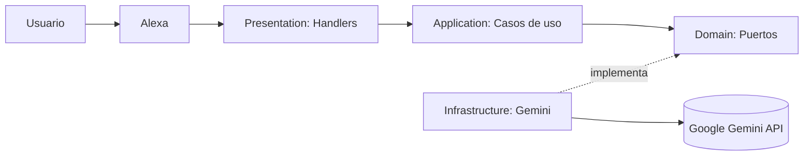

# alexa-gemini-skill

Skill personal de Alexa en español que responde preguntas usando la IA de **Google Gemini**, para que Alexa sea más inteligente de forma gratuita.

Es un proyecto **open source**: quien quiera usarla despliega su propia copia con su propia API key de Gemini.

> 🚧 Proyecto en construcción. Este documento describe lo que se va a realizar.

## 🎯 Objetivo

- Hacer preguntas a Alexa en lenguaje natural y recibir respuestas generadas por Gemini.
- Mantener el contexto de la conversación durante la sesión.
- Respuestas cortas y naturales, pensadas para escucharse.
- Código limpio, probado y fácil de desplegar.

## 🛠️ Stack

- **Lenguaje:** TypeScript sobre Node.js
- **Alexa:** ASK SDK (`ask-sdk-core`) y ASK CLI
- **IA:** Google Gemini (`@google/genai`)
- **Hosting:** Alexa-hosted o AWS Lambda
- **Calidad:** Jest, ESLint y Prettier
- **CI:** GitHub Actions

## 🏗️ Arquitectura

Se usará **Arquitectura Limpia**, con las dependencias apuntando siempre hacia el dominio:

```
lambda/src/
├── domain/          # Entidades, puertos (interfaces) y errores del negocio
├── application/     # Casos de uso
├── infrastructure/  # Gemini, persistencia de sesión y configuración
└── presentation/    # Handlers de Alexa
```



## 📋 Plan de trabajo

- [x] Estructura inicial del proyecto
- [ ] Configuración de TypeScript, ESLint, Prettier y Jest
- [ ] Dominio: entidades `Message` y `Conversation`, puertos `AIProvider` y `ConversationRepository`
- [ ] Casos de uso: hacer una pregunta y reiniciar la conversación
- [ ] Infraestructura: proveedor de Gemini y memoria en la sesión de Alexa
- [ ] Handlers de Alexa: bienvenida, pregunta, ayuda, cancelar, salir y errores
- [ ] Modelo de interacción en español (es-MX y es-ES)
- [ ] Pruebas unitarias del dominio y los casos de uso
- [ ] Pipeline de CI con GitHub Actions
- [ ] Guía de instalación paso a paso
- [ ] Video demo

## 🚀 Roadmap futuro

- Pantallas visuales con APL para Echo Show
- Memoria persistente con DynamoDB
- Panel web en Next.js para configurar la skill

## 🔐 Variables de entorno

Ver `.env.example`. La API key nunca se sube al repositorio.

| Variable         | Descripción                                    |
| ---------------- | ---------------------------------------------- |
| `GEMINI_API_KEY` | API key gratuita de Google AI Studio           |
| `GEMINI_MODEL`   | Modelo a usar (por defecto `gemini-2.5-flash`) |

## 📄 Licencia

MIT © 2026 [Stiven Chacon](https://github.com/Stiven-Chacon) · [Portafolio](https://stivenchacon.netlify.app/)
