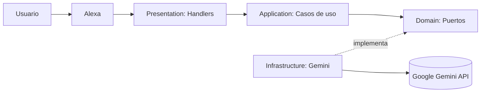

# alexa-gemini-skill

Skill personal de Alexa en español que responde preguntas usando la IA de **Google Gemini**, para que Alexa sea más inteligente de forma gratuita.

Es un proyecto **open source**: quien quiera usarla despliega su propia copia con su propia API key de Gemini.

## Objetivo

- Hacer preguntas a Alexa en lenguaje natural y recibir respuestas generadas por Gemini.
- Respuestas cortas y naturales, pensadas para escucharse.
- Código limpio, probado y fácil de desplegar.
- Más adelante, mantener el contexto de la conversación durante la sesión (aún no está implementado).

## Qué hace hoy

- Invocación: **asistente nova**, locale **es-US**.
- Preguntas en lenguaje libre (`AskGeminiIntent`).
- Tras cada respuesta, pregunta si quieres algo más: **sí** sigue la conversación y **no** (u otras negaciones) cierra la sesión.
- Ayuda, cancelar, salir y mensajes de error claros (timeout, servicio ocupado, pregunta vacía o demasiado larga, etc.).
- Llamadas a Gemini con conexión persistente (keep-alive), presupuesto total de 7 segundos y un reintento si la API responde 503 o 429.

## Stack

- **Lenguaje:** JavaScript (Node.js, CommonJS).
- **Alexa:** ASK SDK (`ask-sdk-core`) y ASK CLI.
- **IA:** Google Gemini, llamado con el módulo nativo `https` (keep-alive). No se usa el paquete `@google/genai`.
- **Modelo por defecto:** `gemini-3.1-flash-lite` (configurable con `GEMINI_MODEL`).
- **Hosting:** skill Alexa-hosted (AWS Lambda).
- **Calidad:** Jest 29, ESLint 9 y Prettier 3 en la raíz del repositorio.
- **CI:** GitHub Actions corre lint, revisión de formato y tests en cada push y pull request a `main` y `dev`.

El builder de Alexa-hosted usa **Node 16**. Por eso `lambda/package.json` solo incluye dependencias de runtime. Jest, ESLint, Prettier y los scripts de desarrollo viven en el `package.json` de la raíz, que Amazon no instala.

## Arquitectura

El código del Lambda sigue **Arquitectura Limpia**, con las dependencias apuntando siempre hacia el dominio:

```
lambda/src/
├── domain/            # Entidad Question, puerto AIProvider y errores
├── application/       # Caso de uso AskQuestionUseCase
├── infrastructure/    # GeminiProvider, configuración y persistencia (aún vacía)
├── presentation/      # Handlers de Alexa, messages y speech
└── container.js       # Composición de dependencias
lambda/tests/          # Pruebas unitarias (Jest, se ejecutan desde la raíz)
```



## Cómo empezar

1. Clona el repositorio y, en la raíz, copia `.env.example` a `.env`. Completa `GEMINI_API_KEY` con tu clave de [Google AI Studio](https://aistudio.google.com/).
2. Instala las dependencias de desarrollo y ejecuta las pruebas:

```bash
npm install
npm test
npm run test:coverage
```

3. Revisa y corrige el estilo del código:

```bash
npm run lint          # revisa el código con ESLint
npm run lint:fix      # corrige lo que ESLint pueda arreglar solo
npm run format        # formatea con Prettier
npm run format:check  # verifica el formato sin cambiar archivos
```

4. Para probar Gemini en local (usa el `.env` de la raíz):

```bash
npm run ask:gemini -- "¿Cuál es el río más largo del mundo?"
```

La API key se configura fuera del repositorio (variable de entorno o archivo `.env` local, que está en `.gitignore`). Nunca se sube a GitHub.

### Integración continua

El workflow `.github/workflows/ci.yml` instala dependencias y corre `lint`, `format:check` y `npm test`. Si el nombre de la rama contiene `hotfix`, los tests se saltan para agilizar correcciones urgentes. El lint y el formato se revisan siempre.

### Despliegue

Este skill está pensado para **Alexa-hosted**. El código del Lambda se publica haciendo push al repositorio CodeCommit que Alexa asocia a la skill. Si cambias el modelo de interacción (`skill-package/interactionModels`), hay que pulsar **Build skill** en la consola de Alexa para que el cambio tenga efecto. Después puedes probarla en la pestaña **Test**.

## Variables de entorno

Ver `.env.example`. La API key nunca se sube al repositorio.

| Variable         | Descripción                                         |
| ---------------- | --------------------------------------------------- |
| `GEMINI_API_KEY` | API key gratuita de Google AI Studio                |
| `GEMINI_MODEL`   | Modelo a usar (por defecto `gemini-3.1-flash-lite`) |

## Licencia

MIT © 2026 [Stiven Chacon](https://github.com/Stiven-Chacon) · [Portafolio](https://stivenchacon.netlify.app/)
